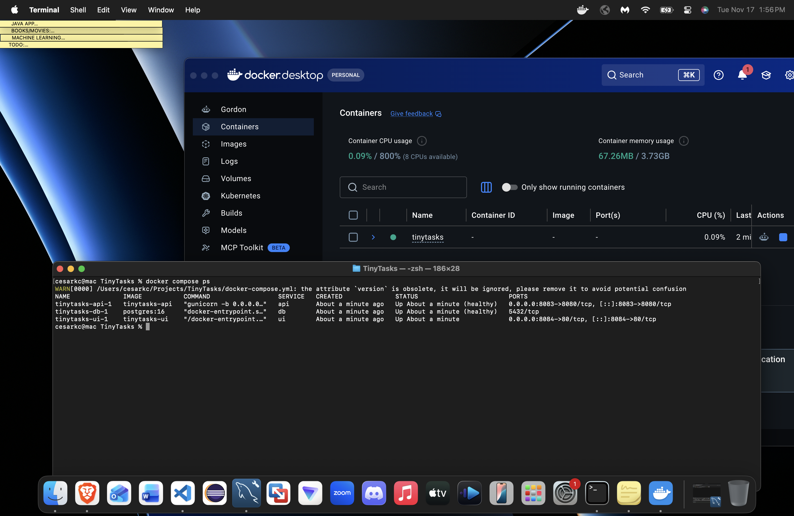
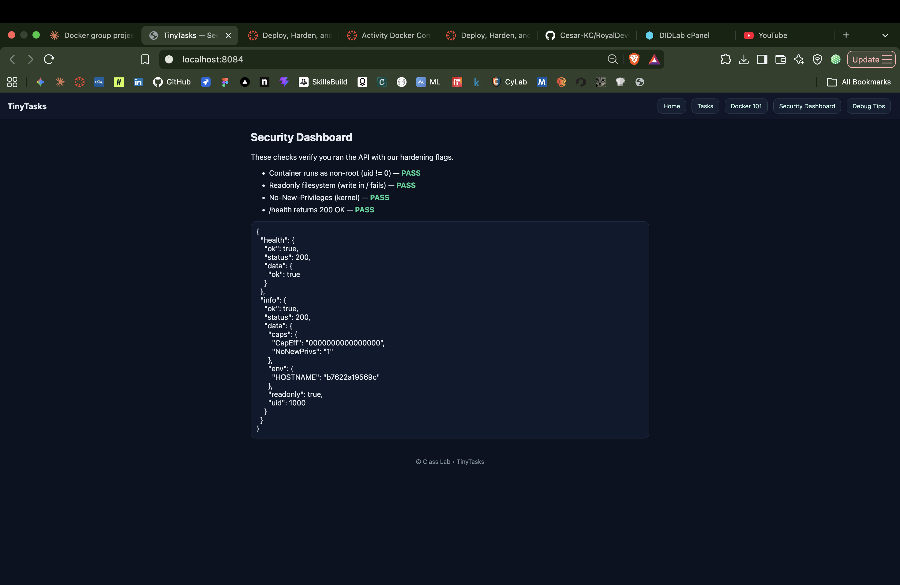
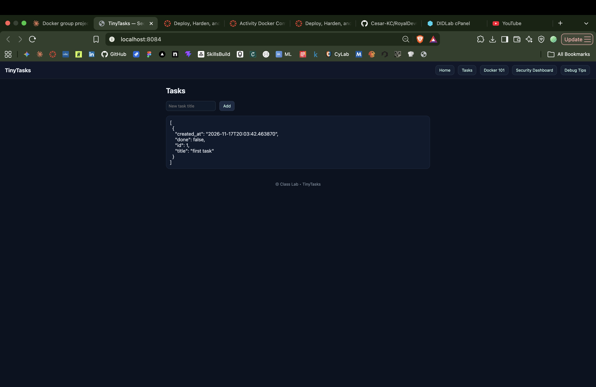

# TinyTasks: Docker Deployment & Container Hardening Lab

**Group 5:** Cesar Giner, Anthony, Yves, Ty, Aketh

TinyTasks is a deliberately small to-do app (add and list tasks) used as a practice target for deploying a multi-service app with Docker Compose, applying container security hardening, and debugging common production-style issues.

## Stack

| Service | Technology | Role | Port (host → container) |
|---|---|---|---|
| `db` | Postgres 16 | Stores tasks | Not published (internal network only) |
| `api` | Flask + gunicorn | REST API + `/security/info` self-check | `8083 → 8080` |
| `ui` | nginx | Web UI + Security Dashboard | `8084 → 80` |

## Quick Start

Requires Docker Desktop (macOS/Windows) or Docker Engine + Compose v2 (Linux). No local Python or Postgres needed.

```bash
git clone https://github.com/Cesar-KC/TinyTasks.git
cd TinyTasks
docker compose up -d --build
docker compose ps
```

- UI: http://localhost:8084
- API health: http://localhost:8083/health
- Stop: `docker compose down`
- Reset database (dev only): `docker compose down -v`

## Security Hardening (api service)

| Control | Where | Risk reduced |
|---|---|---|
| Non-root user (uid 1000) | `app/Dockerfile` (`USER appuser`) + compose `user:` | A compromised app process does not have root |
| Read-only root filesystem + `tmpfs /tmp` | `docker-compose.yml` | Blocks tampering and planting persistent files |
| `cap_drop: ALL` + `no-new-privileges` | `docker-compose.yml` | Removes kernel privileges; blocks escalation via setuid binaries |
| Healthchecks | `app/Dockerfile` + `docker-compose.yml` | Detects failures; `api` waits for a healthy `db` |
| Database not published | `docker-compose.yml` | Postgres reachable only from the internal Docker network |

**Verified live** on the Security Dashboard via `/security/info`: `uid=1000`, `readonly=true`, `NoNewPrivs=1`, `CapEff=0000000000000000` (zero effective capabilities).

## Fixes Made to the Provided Lab Code

1. **`init_db()` never ran under gunicorn.** It sat inside `if __name__ == "__main__":`, which is skipped when gunicorn imports the app, so the `tasks` table was never created. Fixed by calling `init_db()` at module import.
2. **`pip install /wheels/` failed the build.** Restored to `/wheels/*`.
3. **Missing `*` characters** in the apt cleanup line and the CSS universal selector were restored.
4. **Truncated Dockerfile** (`unknown instruction: HEAL`): an incomplete paste cut off the `HEALTHCHECK` and `CMD` lines. Restored and verified with `tail`.
5. **Added `.gitignore`** to keep macOS metadata, `.bak` config backups, and Python cache out of the repo.

## Progress

- [x] Stack deployed locally, all services healthy
- [x] Security Dashboard: all checks PASS
- [x] Task created via API and visible in UI
- [ ] Part 3: debug injected issues 1–3 + debug journal
- [ ] Security write-up
- [ ] Deploy to https://group5.didlab.org

## Deliverable Screenshots

### 1. `docker compose ps`: all services up and healthy


### 2. Security Dashboard: all checks PASS


### 3. Tasks page listing an added task


## Repo Structure

```
TinyTasks/
├─ app/
│   ├─ app.py
│   ├─ requirements.txt
│   └─ Dockerfile
├─ frontend/
│   ├─ Dockerfile
│   ├─ nginx.conf
│   ├─ index.html
│   ├─ app.js
│   └─ styles.css
├─ screenshots/
├─ docker-compose.yml
├─ .env
├─ .gitignore
└─ README.md
```

## Note on `.env`

`.env` contains **development placeholder values only** and is committed because the assignment requires it. In a real project, `.env` would be listed in `.gitignore`, and a `.env.example` with placeholders would be committed instead.